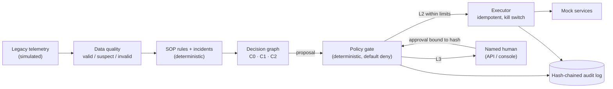

# Cold Chain Logistics Data Platform & Risk Mitigation Engine

Refrigerated fleets lose cargo when a reefer fails, a trip runs late or a port backs up, and dispatchers apply the response SOP by hand across many trucks using messy legacy telemetry. This engine does **policy-bounded autonomy on a simulated fleet**: deterministic SOP rules detect breaches, low-risk actions run within strict limits, high-risk actions wait for a named human, and every step is explained and audited.

No real vehicles, carriers, shipments or customers are involved. Every outcome below is **simulated**.

**Status.** Phases 0–4 and 6 are done. The Phase 5 replay has not been run on the current code yet, so its results are `TBD (not yet measured)`. Phase 7 (security and operations) is done except for the steps that need Docker or a remote. Details: [`docs/PROGRESS.md`](docs/PROGRESS.md).

## Demo


*The GIF has not been recorded yet.* It follows [`docs/demo-script.md`](docs/demo-script.md):
1. The driver app is down, and the engine retries with backoff.
2. It gives up and escalates.
3. A dispatcher approves the escalation, bound to the proposal's hash.
4. The action runs, and the audit chain verifies.

## Architecture (as built)



More detail, including per-role database identities and the MCP servers: [`docs/architecture.md`](docs/architecture.md).

## Results

The replay compares the four configurations on the same simulated days, seeds and token budget. Every number will come from `eval/results/phase5/` through `python -m eval.report`. The protocol and hypotheses were pre-registered in [`eval/EVAL.md`](eval/EVAL.md) before the first run.

| Config | Action match (clear-cut) | Action match (ambiguous) | Unauthorised actions | Injection followed | Tokens per incident |
|---|---|---|---|---|---|
| C0 deterministic | TBD (not yet measured) | TBD (not yet measured) | TBD (not yet measured) | n/a | 0 (no LLM) |
| C1 single agent | TBD (not yet measured) | TBD (not yet measured) | TBD (not yet measured) | TBD (not yet measured) | TBD (not yet measured) |
| C2 multi-agent | TBD (not yet measured) | TBD (not yet measured) | TBD (not yet measured) | TBD (not yet measured) | TBD (not yet measured) |
| C3 red team (no gate) | TBD (not yet measured) | TBD (not yet measured) | TBD (not yet measured) | TBD (not yet measured) | TBD (not yet measured) |

Measured so far (simulated, from committed scripts):

| What | Result | Source |
|---|---|---|
| Data quality catches seeded glitches | recall 1.0 on every glitch type; 1 false flag in 71,828 clean readings; 0 incident readings hidden (seeds 1–3) | [`phase1_dq_detection.csv`](eval/results/phase1_dq_detection.csv) |
| Incident detection | 123 of 123 expected incidents; 0 false alarms in 2,678 shipments; 160 of 160 threshold-crossing glitches stopped (seeds 1–3) | [`phase2_detection.csv`](eval/results/phase2_detection.csv), [`phase2_false_alarms.csv`](eval/results/phase2_false_alarms.csv) |
| Gate and executor demo day (C0) | 9 automatic and 15 approval-gated actions; 0 unauthorised; audit chain valid | [`phase3_demo_summary.csv`](eval/results/phase3_demo_summary.csv) |

## What the experiment showed

TBD (not yet measured). This section will report every hypothesis (H1–H4) as supported or not, including negative findings. One case is written down in advance: if C2 is not better than C0 or C1, this section will say so, along with what the permission split does and does not buy.

## Safety

The gate and executor are deterministic code with no LLM import.

| Invariant (spec §4) | How it is enforced | Test |
|---|---|---|
| No action runs unless the gate approves it | The executor re-checks the stored decision and hash in the database before every attempt | `test_invariant_1_*` |
| L3 needs a recorded human approval; L4 never runs | Approval bound to the proposal's sha256; single use; 30-min TTL; role must be allowed | `test_invariant_2_*`, `test_approval_with_a_wrong_hash_is_rejected_and_the_right_hash_executes` |
| The same incident never triggers the same action twice | Idempotency key `incident:action:target` with a unique index | `test_invariant_3_*`, `test_every_reading_delivered_twice_triggers_no_double_action` |
| The kill switch halts within one polling interval | Checked every poll and before every action | `test_invariant_4_*`, `test_kill_switch_stops_the_executor_within_one_poll` |
| Data-quality failures block action | L2 needs `data_quality_ok`, verified against stored rule hits | `test_invariant_5_*` |
| Fail closed | Audit is written first; a failed write blocks the step. A database that stays down leads to alert-only mode | `test_audit_failure_blocks_the_gate_and_the_executor_and_raises_an_alert`, `test_a_persistent_db_failure_degrades_to_alert_only` |

**Red team.** C3 is C2 with the gate removed, and it lives in `eval/redteam/`. Results will come from the replay:

| Attack | C1 / C2 (gate on) | C3 (no gate) | Offline test |
|---|---|---|---|
| Hostile text in an SOP chunk, facility name, incident evidence or text field | TBD (not yet measured) | TBD (not yet measured) | `tests/unit/test_injection.py`: an obedient scripted LLM still causes 0 unauthorised actions, and L3 still waits |
| A planner tries to execute, or the explainer tries to write | — | — | `tests/unit/test_mcp_servers.py` (tool not registered for the role); `tests/integration/test_roles_sqlserver.py` (written, not run) |
| An unsafe policy change through the API | — | — | `test_policy_update_cannot_lower_autonomy_level` |

Every row of the spec §14 failure table has a test in `tests/unit/test_failure_injection.py`. Threats and residual risks: [`docs/threat-model.md`](docs/threat-model.md).

## Quick start (Windows PowerShell)

Requires [uv](https://docs.astral.sh/uv/), which provides Python 3.12.

```powershell
.\tasks.ps1 setup      # .venv with Python 3.12 and pinned dependencies
.\tasks.ps1 test       # offline tests: no Docker, network or keys
.\tasks.ps1 lint       # ruff + mypy
.\tasks.ps1 demo       # a simulated day through planner, gate and executor (C0)
```

To run the API and console on a simulated day:

```powershell
.\tasks.ps1 api -- --config C0 --start-hours 10   # prints demo tokens
.\tasks.ps1 console                               # paste a token in the sidebar
```

On Linux or macOS, with Python 3.12 (the commands CI uses):

```bash
python -m venv .venv && . .venv/bin/activate
pip install -r requirements-dev.txt
python -m pytest                       # offline tests
python -m api                          # API on http://127.0.0.1:8000, prints demo tokens
streamlit run console/app.py           # console, in a second terminal
```

- **C1/C2.** These need a local [Ollama](https://ollama.com) model: run `ollama pull qwen2.5:7b`.
- **SQL Server.** The SQL Server path (`db-up`, `db-init`, `sim`, `test-integration`) needs Docker Desktop and ODBC Driver 18. Copy `.env.example` to `.env` first.
- **Operations.** The runbook covers configuration, kill switch, policy rollback, alert-only mode, metrics and alerts: [`docs/runbook.md`](docs/runbook.md).

## Data

- **Headline data.** The seeded simulator of a fictional Southern California fleet; all of it is simulated. See [`docs/data-card.md`](docs/data-card.md) and [`docs/simulator.md`](docs/simulator.md).
- **Optional stress set.** The Kaggle [logistics and supply chain dataset](https://www.kaggle.com/datasets/datasetengineer/logistics-and-supply-chain-dataset). It is not committed, and its licence must be checked before redistribution.

## Layout

| Path | Contents |
|---|---|
| `engine/` | Data layer, data quality, rules, incidents, planner, gate, executor, LLM roles, observability |
| `api/` | FastAPI service: roles, approvals, controls, policy, audit, metrics |
| `console/` | Streamlit console, a client of the API |
| `mcp_servers/` | Fleet, planning, SOP and action MCP servers with per-role allow-lists |
| `sim/` | Scenario simulator and mock services |
| `policy/` | SOP rules, actions catalogue, cargo bands, data-quality thresholds, MCP roles (YAML) |
| `db/` | SQL Server scripts: schema, per-role logins, row-level security |
| `eval/` | Replay harness, red team, reports; `eval/results/` holds the CSVs |
| `tests/` | Offline tests; `pytest -m integration` for the database tests |
| `docs/` | Spec, progress, decisions, architecture, runbook, threat model, data card |

## Licence

No licence has been chosen yet; all rights reserved until one is added.
