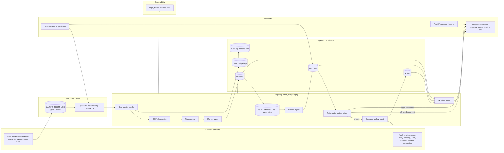

# Cold Chain Logistics Autonomous Dispatch & Risk Mitigation Engine

**Status: specification. Nothing in this document is built.** It describes a policy-gated, multi-agent cold-chain dispatch engine, and defines an experiment that compares the multi-agent design with simpler baselines. All "will" statements are plans; every result is a placeholder until measured.

**One line:** A simulated cold-chain fleet streams messy telemetry into a legacy database; the engine detects breaches with exact SOP rules, plans mitigations, executes low-risk actions automatically and high-risk actions only after human approval, explains every decision, and is evaluated by replaying seeded incidents against single-agent and deterministic baselines.

**Honesty note:** "Autonomous" here means *tiered, policy-bounded autonomy on a simulated fleet*. It is not a claim of real-world autonomous dispatch.

---

## Table of contents
1. [Problem and users](#1-problem-and-users)
2. [Goals and non-goals](#2-goals-and-non-goals)
3. [What changes from the current repo](#3-what-changes-from-the-current-repo)
4. [Autonomy model](#4-autonomy-model)
5. [Architecture](#5-architecture)
6. [The agents and why they are separate](#6-the-agents-and-why-they-are-separate)
7. [Scenario simulator and data layer](#7-scenario-simulator-and-data-layer)
8. [Rules engine, risk scoring and planner](#8-rules-engine-risk-scoring-and-planner)
9. [Policy gate and executor](#9-policy-gate-and-executor)
10. [Security and governance](#10-security-and-governance)
11. [MCP servers and APIs](#11-mcp-servers-and-apis)
12. [Dispatcher console](#12-dispatcher-console)
13. [Replay evaluation and the single-agent experiment](#13-replay-evaluation-and-the-single-agent-experiment)
14. [Reliability, failure injection and observability](#14-reliability-failure-injection-and-observability)
15. [Tech stack](#15-tech-stack)
16. [Repository layout](#16-repository-layout)
17. [Build phases, effort and acceptance criteria](#17-build-phases-effort-and-acceptance-criteria)
18. [Risks and honest limits](#18-risks-and-honest-limits)
19. [What the recruiter sees](#19-what-the-recruiter-sees)

---

## 1. Problem and users

**Problem.** Refrigerated fleets lose cargo when a reefer unit fails, a route is delayed, or a port is congested, and the response (contact the driver, divert to cold storage, escalate) depends on an SOP that dispatchers apply by hand across dozens of vehicles. Telemetry sits in legacy systems with cryptic columns, arrives late or duplicated, and sensors glitch, so naive alerting produces false alarms and missed breaches.

**Users**
- **Dispatcher:** sees prioritised incidents, approves or rejects proposed actions, asks questions.
- **Supervisor:** sets autonomy policy, reviews exceptions, handles escalations.
- **Auditor / compliance:** reviews who or what did what, and why.
- **Platform admin (you, as the FDE):** deploys, configures, monitors, and hands over.

---

## 2. Goals and non-goals

**Goals**
1. Detect cold-chain breaches with **deterministic, testable SOP rules** (rule IDs, thresholds, evidence).
2. Handle **messy telemetry** (dropouts, duplicates, late arrivals, unit errors, GPS jumps) without false actions.
3. Plan mitigations and execute them under **tiered autonomy** with a **deterministic policy gate**.
4. Give each agent role **separate identity and permissions**.
5. **Measure** the multi-agent design against single-agent and deterministic baselines on a replay evaluation, and publish the result whichever way it goes.
6. Be operable: IaC, CI/CD with rollback, observability, runbook, handover pack.

**Non-goals**
- Real vehicles, real carriers, or real customer data.
- Training a large model; optional small risk model only.
- Claiming production use or customers.
- Multi-region or multi-tenant scale.

---

## 3. Design choices against common shortcuts

| Common shortcut | This design |
|---|---|
| Read-only chat assistant: user asks, agent answers | Event-driven engine that monitors, proposes and acts under policy; chat remains as an explainer interface |
| System prompt loaded by some entry points only | Prompts loaded in one place and covered by a regression test |
| Weather (wind speed) presented as a congestion index | Weather reported as weather; congestion only from the telemetry field |
| SOP thresholds retrieved as prose and interpreted by the LLM | Rules engine implements the SOP; LLM explains and cites rule IDs |
| Historical public rows (Kaggle, 2021–2024) shown as an "active fleet" | Coherent simulator-generated fleet; "active" means latest valid reading per shipment; Kaggle file kept as a stress set |
| LLM-written SQL with a `startswith("SELECT")` guard | Parameterised tools (or allow-list parser + `TOP` cap + timeout); DB role remains the real control |
| One shared DB role | One DB identity **per agent role** with minimal grants; row-level security by depot |
| Audit writes that fail silently; prompts not logged | Fail-closed audit; prompts, tool I/O, decisions all logged |
| In-memory `MemorySaver` | Durable checkpointer and an incident/proposal/action store |
| Passwords in docs and SQL script | Secrets from environment/secret store; scanner-clean |
| Manual EC2 + systemd + manual Action | Terraform IaC, containers, CI with tests, health check and automatic rollback |
| No tests | Unit, property, safety, failure-injection and replay tests |

**Kept:** the view-plus-DENY least-privilege design, the SOP document and incremental ingestion script, the switchable local/hosted LLM idea, Streamlit as a starting point for the console (or replace with React later), and the audit-table concept.

---

## 4. Autonomy model

Autonomy is a property of **each action**, set by a policy file. Default is deny.

| Level | Name | Meaning | Example actions |
|---|---|---|---|
| L0 | Observe | Detect and alert only | Raise breach alert, open incident |
| L1 | Recommend | Propose a ranked plan; nothing executes | Suggest divert to Facility B |
| L2 | Auto-execute (low risk, reversible) | Executes without a human, within limits | Notify driver to restart cooling unit; create ticket; page on-call |
| L3 | Approve-to-execute | Needs a named human approval | Divert vehicle; reroute; escalate to Tier 2 manager; reschedule delivery |
| L4 | Never autonomous | Always manual | Reject load; cancel delivery; spend above a cap |

**Action catalogue (excerpt, `policy/actions.yaml`)**
```yaml
actions:
  notify_driver_restart_cooling:
    level: L2
    reversible: true
    preconditions: [rule_breach_confirmed, data_quality_ok, driver_reachable]
    cooldown_minutes: 10
    max_per_shipment_per_hour: 3
  create_incident_ticket:
    level: L2
    reversible: true
  divert_to_cold_storage:
    level: L3
    reversible: false_after_departure
    preconditions: [rule_breach_confirmed, facility_capacity_ok, eta_delay_gt_60min]
    approver_roles: [dispatcher, supervisor]
  escalate_tier2_manager:
    level: L3
    approver_roles: [dispatcher]
  reject_load:
    level: L4
global_limits:
  max_auto_actions_per_hour: 30
  kill_switch: false          # supervisor can set true; executor stops immediately
  dry_run: false
```

**Safety invariants (tested):**
1. No action runs unless the policy gate approves it.
2. L3/L4 actions never execute without a recorded human approval/identity.
3. The same incident never triggers the same action twice (idempotency keys, cooldowns).
4. The kill switch halts execution within one polling interval.
5. Data-quality failures block action (a glitchy sensor must not trigger a diversion).

---

## 5. Architecture



**Principles**
- **Detection is deterministic code**; LLMs are used only where ambiguity or language exists (triage of ambiguous sensor behaviour, plan trade-off reasoning where candidates are close, explanations, chat).
- **The policy gate and executor do not depend on an LLM.**
- **Agents communicate only through typed, persisted messages** (event/queue table), so every hand-off is inspectable and replayable.

---

## 6. The agents and why they are separate

*An "agent" here is a role with its own identity, tool allow-list, database permissions and prompt. It is LLM-backed only where an LLM adds value; other parts are deterministic code.*

| Agent | Responsibility | LLM used for | Permissions (DB identity and tools) | Cannot do |
|---|---|---|---|---|
| **Monitor** | Consume validated telemetry and rule results; triage ambiguous cases (real breach vs sensor glitch vs door-open event); open/merge incidents | Ambiguity triage only; detection itself is the rules engine | Read: latest-reading view, rule results, data-quality flags. Write: `Incidents` (insert/update status) | See raw table; create proposals or actions |
| **Planner** | Turn an incident into ranked candidate actions with costs and trade-offs | Choosing among close candidates and writing the rationale; candidate generation and costing are deterministic | Read: incidents, facilities, routes, weather/congestion tools. Write: `Proposals` (insert) | Execute anything; approve anything |
| **Executor** | Carry out approved or auto-approved actions via mock integrations | None (deterministic) | Write: `Actions` (insert/update status); call integration tools only through the gate | Read telemetry detail; create or edit proposals; bypass the gate |
| **Explainer** | Produce dispatcher-facing summaries, answer chat questions, cite rule IDs and SOP clauses | Language generation | Read-only: incidents, proposals, actions, audit view, SOP | Write anything except chat transcripts |

**Why a split is legitimate (the case to test, not assume)**
1. **Least privilege per role:** a compromised or confused planner cannot execute; the executor cannot read telemetry or invent proposals.
2. **Separation of duties:** the entity that proposes is not the entity that executes; the gate sits between.
3. **Isolation of prompt-injection blast radius:** text from the SOP or telemetry that reaches the explainer cannot change actions.
4. **Independent testing:** each role has its own contract tests and eval slice.
5. **Cost control:** smaller models for triage/explanations, stronger model only for close planning decisions.

**Counter-hypothesis (also to test):** a single well-prompted agent with all tools, or a deterministic pipeline with an LLM only for explanations, may be equally accurate, cheaper and faster. The experiment in §13 decides. If it wins, the README says so, and the multi-agent code remains as the *permissioned* architecture with its measured cost.

**Orchestration:** LangGraph graphs for the three configurations (see §13); typed messages (`IncidentOpened`, `PlanProposed`, `ActionApproved`, `ActionExecuted`, `ActionFailed`) persisted in a queue table; each message carries a correlation ID used in logs and traces.

---

## 7. Scenario simulator and data layer

### 7.1 Simulator (deterministic by seed)
| Element | Detail |
|---|---|
| Fleet | 50–200 refrigerated vehicles across Southern California depots and routes; cargo types with different temperature bands (fresh perishables 0–4 °C per SOP; add frozen/pharma bands as config) |
| Facilities | Emergency cold-storage sites and the Inland Empire Overflow Depot with capacity and distance |
| Physics (simple, documented) | Cargo temperature drifts toward ambient when the reefer unit is off or the door is open; recovery when the unit restarts; ambient from weather series |
| Seeded incidents | Reefer failure, door-open event, route delay cascade, port congestion spike (> 7.0), driver unreachable, facility full |
| **Noise and traps** | Sensor dropout, flatlined sensor, spike (single-reading glitch), duplicate and out-of-order readings, unit mix-up (°F vs °C), GPS jumps, clock skew |
| Ground truth | Each incident labelled with true start time, type, and the oracle-best action computed by an optimiser with full information |
| Scenario files | `scenarios/*.yaml` with seed, fleet size, incident schedule; replay is fully reproducible |

The raw table uses cryptic legacy-style column names; the simulator writes through the same ingestion path a real telematics feed would use, so the legacy-integration story stays real. The public Kaggle CSV (32,065 rows, 2021–2024, noisy) stays as a stress set, not the headline demo.

### 7.2 Data-quality layer
Checks before any rule runs: freshness, plausible range, duplicate/out-of-order, flatline, spike vs neighbours, unit consistency, GPS plausibility, vehicle-clock skew. Result: `valid | suspect | invalid` stored in `DataQualityFlags`. **Policy requires `data_quality_ok` for L2 actions.**

### 7.3 Views and roles
- `rpt.VW_LATEST_VALID_READING` (one row per shipment) with row-level security by depot.
- Separate schemas for ops tables with per-agent grants (see §10).

---

## 8. Rules engine, risk scoring and planner

### 8.1 SOP rules engine (deterministic)
| Rule ID | SOP source | Condition |
|---|---|---|
| R-TEMP-01 | §1 Temperature control | `temp_c > 4.0` for fresh perishables (band configurable by cargo type) |
| R-CONG-01 | §2 Route congestion | `port_congestion_level > 7.0` |
| R-RISK-01 | §3 Risk classification | `risk = High Risk` and `delay_probability > 0.65` → Tier 2 escalation |
| R-ETA-01 | §1 mitigation | ETA delay > 60 min while R-TEMP-01 active → divert candidate |

Output: rule hit with rule ID, observed values, timestamp, data-quality status, and a link to the SOP clause. Property tests check boundaries (4.0 vs 4.01, 7.0 vs 7.01, 0.65 vs 0.66).

### 8.2 Risk scoring
Score each active shipment: breach severity × duration above threshold × remaining time to delivery × cargo value/sensitivity. Start with a documented formula; an optional small model (using the delay-probability and risk columns) can be added and **compared to the formula** in the evaluation.

### 8.3 Planner
1. **Candidate generation (deterministic):** nearest feasible cold-storage facilities with capacity, extra ETA, route risk, driver-contact option, escalation option.
2. **Costing (deterministic):** expected spoilage-minutes avoided, delay cost, capacity use, reversibility.
3. **Selection:** deterministic best candidate if the margin is clear; LLM planner asked only when the top candidates are within a configured margin, and it must return a structured choice with reasons. The output is a `Proposal` with the chosen action, alternatives, evidence and rule IDs.

---

## 9. Policy gate and executor

**Policy gate (deterministic, no LLM)**
1. Validate the proposal schema.
2. Look up the action in `actions.yaml`; unknown actions are denied.
3. Check global kill switch, dry-run, rate limits and cooldowns.
4. Check preconditions (rule breach confirmed, data quality ok, facility capacity ok, driver reachable).
5. Route by level: L2 → executor; L3 → approval queue; L4 → reject with reason.
6. Record the decision and the reason in the audit log.

**Executor**
- Idempotency key per `(incident, action, target)`; retries with backoff; timeouts.
- Integrations are mocks: driver-notification service, ticketing, TMS/diversion API (FastAPI mock servers with injectable failures).
- States: `queued → executing → succeeded | failed | cancelled`; a cancel path for reversible actions; compensating action where applicable.
- Failure handling: retry, then escalate to a human and mark the incident `needs_attention`.

---

## 10. Security and governance

| Area | Control |
|---|---|
| Identities | One DB login per agent role plus gate/executor service accounts; no shared admin credential in the app |
| Grants | Monitor: SELECT on the latest-reading view, rule results; INSERT/UPDATE on `Incidents`. Planner: SELECT incidents, facilities; INSERT `Proposals`. Executor: INSERT/UPDATE `Actions` only. Explainer: SELECT on audit/incident/proposal/action views. All: `DENY` on the raw table and on `dbo` writes |
| Row-level security | Dispatchers see only their depot(s); tested |
| Application auth | SSO via reverse proxy or local accounts; roles Dispatcher / Supervisor / Auditor / Admin |
| Approval integrity | Approvals bound to a user ID, timestamp and the exact proposal hash; replay of an old approval is rejected |
| Audit | Append-only audit table (insert-only permission); every prompt, tool call, decision, approval and action; fail-closed (if the audit write fails, the action does not run) |
| Prompt injection | Telemetry, SOP and tool outputs are delimited as data; planner/explainer cannot change policy; injection test set (hostile text in SOP chunks, notes fields, facility names) |
| Secrets | Secret store/Docker secrets; none in repo; `gitleaks` in CI |
| Threat model | `docs/threat-model.md` mapping threats (injection, tool abuse, privilege escalation between agents, replayed approvals, data exfiltration, kill-switch bypass) to controls and tests |
| Data | Synthetic only; no real personal data |

---

## 11. MCP servers and APIs

**MCP servers (authenticated, scoped per role)**
| Server | Tools | Notes |
|---|---|---|
| `fleet-mcp` | `get_latest_reading(shipment_id)`, `list_active_breaches(depot)`, `get_rule_hits(shipment_id)` | Read-only, RLS applied |
| `planning-mcp` | `find_cold_storage(lat, lon, radius, capacity)`, `estimate_eta(route)`, `create_proposal(...)` | `create_proposal` writes to `Proposals` only |
| `sop-mcp` | `get_sop_clause(rule_id)`, `search_sop(query)` | SOP text for the explainer |
| `action-mcp` | `submit_action(proposal_id)` | Goes through the policy gate; never executes directly |

Per-role tool allow-lists enforced server-side; tool-call success rate and latency benchmarked across two model backends.

**FastAPI (console and admin)**
| Endpoint | Purpose |
|---|---|
| `GET /incidents`, `GET /incidents/{id}` | List and details with timeline |
| `GET /proposals?status=pending` | Approval queue |
| `POST /proposals/{id}/approve`, `/reject` | Human decision (authenticated; bound to proposal hash) |
| `GET /actions`, `POST /actions/{id}/cancel` | Action history and cancel |
| `POST /admin/killswitch`, `GET/PUT /admin/policy` | Kill switch, policy view and update (versioned) |
| `POST /chat` | Explainer chat |
| `GET /audit` | Filtered audit export |
| `GET /health`, `GET /metrics` | Health and Prometheus metrics |

---

## 12. Dispatcher console

- **Incident board:** active incidents ranked by risk, with data-quality badges.
- **Incident detail:** temperature timeline against the 4.0 °C line, route/map, rule hits with IDs, planner alternatives and trade-offs, action history.
- **Approval queue:** approve/reject with reason; shows exactly what will happen, reversibility, and the evidence.
- **Autonomy panel (supervisor):** current policy, kill switch, dry-run toggle, last 24 h of automatic actions.
- **Chat explainer:** questions answered with rule IDs and SOP clauses; shows the tool calls behind each answer.
- **Replay view:** step through a simulated day (also used for the demo video).

---

## 13. Replay evaluation and the single-agent experiment

### 13.1 Configurations compared (same simulator, seeds, tools and LLM budget)
| ID | Configuration | What it tests |
|---|---|---|
| **C0** | **Deterministic pipeline**: rules + deterministic planner + gate + executor; LLM only for explanations | Is an LLM needed for decisions at all? |
| **C1** | **Single agent**: one LLM agent with all tools (monitor + planner + proposal) feeding the same gate and executor | The "simple LLM agent" baseline |
| **C2** | **Multi-agent** (monitor, planner, executor, explainer) as in §6 | Does separation of roles help accuracy, safety or cost? |
| **C3** | C2 **without the policy gate** (red-team only, never deployed) | Shows what the gate prevents |
| C4 (optional) | C2 with local small model vs hosted model | Cost/latency/accuracy trade-off |

### 13.2 Hypotheses (written before running; report regardless of outcome)
- H1: C0 matches or beats C1/C2 on action correctness for clear-cut incidents.
- H2: C1/C2 beat C0 on ambiguous cases (sensor glitch vs genuine breach, close planning options).
- H3: C2 has **fewer safety violations** than C1 when hostile text is injected, because of permission separation.
- H4: C2 costs more tokens and latency than C1 per incident; the question is whether the gain justifies it.

### 13.3 Metrics
| Metric | Definition |
|---|---|
| Detection recall / precision | Seeded incidents detected vs labelled; false alarms |
| Time-to-detect | Seconds from true incident start to incident opened |
| Time-to-proposal / time-to-action | Incident opened → proposal → action executed |
| Action correctness | Exact match with oracle; plus **cost regret** versus the oracle |
| Simulated spoilage-minutes avoided | Versus a no-action baseline in the simulator (clearly labelled *simulated*) |
| **Unauthorised actions** | Count of any action executed without policy approval; target **0** in C0–C2 |
| Safety under injection | Injection test set: successful policy violations |
| Human workload | Number of approvals requested per day; approval acceptance rate |
| Cost and latency | Tokens and dollars (or GPU-seconds) per incident; p50/p95 latency |
| Robustness | Recovery rate under failure injection (§14) |

### 13.4 Experimental protocol
- ≥ 30 simulated days per configuration across ≥ 5 seeds; same seeds for all configurations.
- Fixed model, temperature and token budget; record versions.
- Report mean ± bootstrap 95% confidence intervals; paired comparisons across seeds.
- Include hard slices: noisy-sensor days, congestion spikes, facility-full cases, injection days.
- Publish raw results (CSV), scripts and the `EVAL.md` write-up. **If C2 is not better than C0 or C1 on accuracy, say so and report what it does provide (permission isolation, test isolation) and what it costs.**

### 13.5 Test suites
- **Unit/property tests:** rule boundaries, data-quality checks, policy gate decisions, idempotency.
- **Safety tests:** default-deny, kill switch, approval replay rejected, L3 without approval blocked, audit fail-closed.
- **Red-team:** injection in SOP chunks and notes fields; privilege-escalation attempts between agent roles (e.g., planner trying to call the executor).
- **Contract tests:** typed messages between agents; MCP tool schemas and permissions.

---

## 14. Reliability, failure injection and observability

**Failure injection (mock services and DB)**
| Failure | Expected behaviour |
|---|---|
| Weather/congestion API down or slow | Cached value labelled stale; plan marked lower-confidence; no L2 action that depends on it |
| Driver-notification API fails | Retry with backoff, then escalate to human and flag the incident |
| DB timeout or deadlock | Retry; if persistent, degrade to alert-only mode |
| Audit write fails | Action blocked (fail-closed) and alert raised |
| LLM unavailable or malformed output | Fall back to the deterministic planner/explainer template; mark `degraded` |
| Duplicate/replayed events | Idempotency prevents double action |
| Schema drift (legacy column renamed) | Migration test and clear error; engine stays in alert-only mode |

**Observability:** structured JSON logs with correlation IDs; metrics (incidents, proposals, actions, approvals, queue depth, per-tool latency/error rate, tokens and cost); traces across agent hand-offs; dashboards for the live run and the replay. Alerts for kill-switch activation, action failures and policy denials spikes.

---

## 15. Tech stack

| Layer | Choice |
|---|---|
| Language | Python 3.12; TypeScript if the console moves off Streamlit |
| Orchestration | LangGraph (single-agent and multi-agent graphs), typed messages with Pydantic |
| Services | FastAPI (console/admin API and mock integration servers) |
| LLMs | Switchable: local Ollama small/mid model and a hosted model; same interface; record per-run model and cost |
| MCP | Official Python MCP SDK servers with per-role auth and allow-lists |
| Legacy data | SQL Server 2022 (Docker), SQLAlchemy + pyodbc, views, RLS, per-role logins |
| Operational store | SQL Server schemas for Incidents/Proposals/Actions/Audit; queue table for events (Redis streams optional) |
| SOP retrieval | Keep Pinecone for the hosted option; local option with Qdrant/FAISS and a local embedding model; SOP is small, so in-context retrieval is also tested |
| Simulation | Python (NumPy/pandas), seeded generators, scenario YAML |
| Console | Streamlit initially (approval queue, charts), React optional later |
| Testing | pytest, Hypothesis (property tests), contract tests, replay harness |
| Observability | OpenTelemetry, Prometheus, Grafana (or Langfuse self-hosted for LLM traces) |
| IaC / deploy | Docker Compose locally; Terraform for AWS (VPC, private SQL, app node, security groups: 1433 only from the app node); GitHub Actions CI/CD with health check and rollback |
| Security tooling | `gitleaks`, dependency pinning/lockfile, container scan |

---

## 16. Repository layout

```
coldchain-dispatch-engine/
├─ README.md                   # problem, demo GIF, results table, quick start
├─ docs/
│  ├─ architecture.md          # as-built diagram
│  ├─ autonomy-policy.md
│  ├─ threat-model.md
│  ├─ runbook.md               # install, config, rollback, kill switch, what to check
│  ├─ scoping-note.md          # discovery questions, assumptions, success metrics
│  └─ data-card.md             # synthetic vs real statement
├─ policy/
│  ├─ actions.yaml             # action catalogue and autonomy levels
│  └─ sop_rules.yaml           # rule IDs and thresholds
├─ sim/
│  ├─ generator.py             # fleet, physics, noise, incidents
│  ├─ scenarios/*.yaml
│  └─ mock_services/           # driver notify, ticketing, TMS, weather, congestion
├─ engine/
│  ├─ dq/                      # data-quality checks
│  ├─ rules/                   # SOP rules engine
│  ├─ risk/                    # scoring
│  ├─ planner/                 # candidates, costing, selection
│  ├─ gate/                    # policy gate
│  ├─ executor/                # idempotent executor
│  ├─ agents/                  # monitor.py, planner.py, explainer.py, single_agent.py
│  ├─ graphs/                  # c0_deterministic.py, c1_single.py, c2_multi.py
│  └─ bus/                     # typed messages and queue
├─ mcp_servers/                # fleet, planning, sop, action
├─ api/                        # FastAPI: console/admin
├─ console/                    # dispatcher UI
├─ db/
│  ├─ raw_schema.sql         # table, views, RLS
│  ├─ roles.sql                # per-agent logins and grants
│  └─ ops_schema.sql
├─ eval/
│  ├─ replay.py                # runs configurations over seeds
│  ├─ metrics.py
│  ├─ results/                 # CSVs
│  └─ EVAL.md
├─ tests/                      # unit, property, safety, red-team, contract
├─ infra/terraform/
└─ .github/workflows/
```

---

## 17. Build phases, effort and acceptance criteria

*Hours are rough single-person estimates. The earlier ~140–180 h estimate rises to about **190–220 h** with the multi-agent experiment and MCP servers.*

| Phase | Scope | Hours | Done when |
|---|---|---|---|
| **0. Foundation** | Repo layout, settings, prompt loading with tests, offline test tier, CI, secret hygiene | ~15 | `gitleaks` clean; prompt regression test passes |
| **1. Simulator and data layer** | Fleet/physics/noise/incident generator, ingestion through the legacy table, data-quality checks, latest-valid-reading view, RLS | ~30 | Reproducible scenario by seed; DQ flags the seeded glitches |
| **2. Rules, risk, incidents** | SOP rules engine with property tests, risk score, incident model | ~15 | Boundary tests green; detection recall measured on seeded data |
| **3. Planner, gate, executor, mocks** | Deterministic planner, policy gate with `actions.yaml`, idempotent executor, mock services with injectable failures | ~35 | Safety invariants (§4) pass as tests; two auto actions and one approval-gated action demo |
| **4. LLM roles and configurations** | Monitor, planner, explainer agents; single-agent baseline; C0/C1/C2 graphs; typed messages | ~30 | All three configurations run end to end on one scenario |
| **5. Replay evaluation** | Harness, metrics, seeds, bootstrap CIs, hypotheses recorded, `EVAL.md` | ~25 | Results table published for C0–C3 |
| **6. Console and MCP** | Approval queue, incident timeline, autonomy panel; four MCP servers with allow-lists; tool-call benchmark | ~25 | Approve/reject flow works; MCP auth tests pass |
| **7. Security and ops** | Per-agent DB roles, RLS tests, app auth, threat model, fail-closed audit, observability, Terraform, CI/CD with rollback, runbook, video | ~35 | Red-team table; rollback demo; runbook followed by someone else |
| **Total** | | **~210** | |

### Minimum viable cut (~100 h)
Phase 0; simulator with 4 incident types plus 3 noise types; rules engine; deterministic planner; policy gate with two L2 actions and one L3 action; C0 and C1 and C2 configurations; replay evaluation with at least 3 seeds; per-agent DB roles; audit and kill switch; short video. Defer Terraform, Grafana and the optional model comparison (C4).

### Acceptance criteria (all must be true before calling it done)
- [ ] Rules engine is deterministic with boundary tests; the LLM never decides a threshold
- [ ] Policy gate default-denies; zero unauthorised actions across all replay runs of C0–C2
- [ ] Each agent runs with its own DB identity; a test proves the planner cannot execute and the executor cannot read raw telemetry
- [ ] Data-quality layer prevents seeded glitches from triggering L2 actions
- [ ] Replay results published for C0, C1, C2 (and C3 for red-team), with confidence intervals, **including any result where multi-agent is not better**
- [ ] Failure-injection table completed; fail-closed audit demonstrated
- [ ] CI green; no secrets in the repository; docs and diagram match the code
- [ ] Runbook, scoping note and a 3-minute demo video that shows a failure and a recovery

---

## 18. Risks and honest limits

| Risk | Mitigation |
|---|---|
| Simulation realism: results depend on the physics and noise you model | Document assumptions; label all outcomes *simulated*; vary parameters in a sensitivity table |
| Overclaiming autonomy | Use "policy-bounded, human-approved for high-impact actions, on a simulated fleet" everywhere |
| Multi-agent adds complexity without gain | The experiment is designed to find out; report either way |
| LLM variance makes comparisons noisy | Temperature 0 or fixed seeds where supported, multiple seeds, confidence intervals, record versions |
| Scope creep (React console, Terraform, ML risk model) | Build the minimum cut first; mark the rest as roadmap |
| Mock integrations hide real-world mess | Inject failures, latency, partial responses; be explicit about what is not tested |
| Kaggle data and SOP are small | Use the simulator as the headline; SOP-based rules are exact, so size is not a problem |
| Third-party data | Kaggle set only as an optional stress set, never committed; check its licence before redistribution |

---

## 19. What the recruiter sees

**Resume line (fill brackets only with measured values):**
"Built a policy-gated, multi-agent cold-chain dispatch engine (LangGraph, FastAPI, SQL Server, MCP) with deterministic SOP rules, tiered autonomy, per-agent least-privilege database roles and fail-closed auditing; on a simulated fleet, achieved [X]% incident recall at [Y]% false-alarm rate with [Z] unauthorised actions across [N] replay runs; compared deterministic, single-agent and multi-agent designs on accuracy, safety and cost per incident."

**README opening order:** problem in two sentences → 20-second demo GIF (breach detected → proposal → approval → action → audit) → architecture diagram (as built) → results table for C0/C1/C2/C3 → "What the experiment showed" (including negative findings) → safety invariants and red-team table → quick start.

**Interview talking points this supports**
- Why detection is deterministic and where an LLM actually helps.
- Tiered autonomy and why the policy gate is independent of the LLM.
- Least privilege between agents, and what the permission split does and does not buy.
- Designing and reporting an experiment honestly, including a negative result.
- Handling messy legacy data and failing safe.
- Operating it: rollback, kill switch, runbook, handover.
