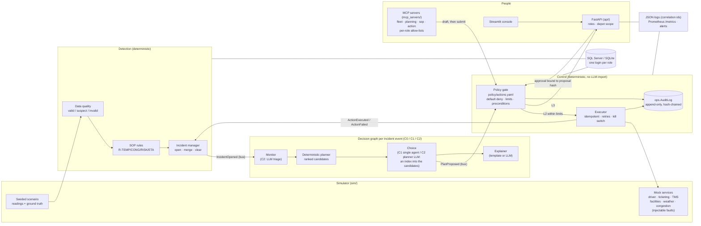

# Architecture (as built)

Policy-bounded autonomy on a simulated fleet. Deterministic code decides thresholds, permissions and whether an action runs. LLM roles only triage, choose among deterministic candidates, and explain.

## Paths through the system

- **Reading → incident.** Each reading goes through data quality (`engine/dq`), then the SOP rules (`engine/rules`), then the incident manager (`engine/incidents`). Only a `valid` reading can open an incident or start a decision. Rule hits are stored with their data-quality status, and the gate verifies the evidence against them later.
- **Incident → proposal.** The decision graph (`engine/graphs`) runs `monitor → plan → choose → submit → explain`. Hand-offs are typed messages in `ops.EventQueue`, each with the correlation id `COR-<incident>`.
  - C0 is fully deterministic.
  - C1 asks one LLM.
  - C2 asks a monitor LLM (temperature incidents only) and a planner LLM (close calls only).
  - Every LLM answer is validated by Pydantic. A failed answer falls back to the deterministic one and is marked degraded.
- **Proposal → action.** The gate is the only path to the executor.
  - L2 actions run within limits and preconditions.
  - L3 actions wait for a named human; the approval must match the proposal's sha256.
  - L4 actions never run.
  - The executor checks the database itself before every attempt, so a forged decision or a row inserted directly never runs.
- **Failures.** A failed action is retried with backoff (60 s, 120 s), then escalated as an L3 proposal, and the incident is flagged.
  - A database that stays down, or a schema drift, puts the engine in alert-only mode.
  - An audit write that fails blocks the step (fail closed).
  - The runbook covers every response.

## Identities

| Role | Login | Can write |
|---|---|---|
| Monitor | `ccx_monitor` | rule hits, incidents, data-quality flags |
| Planner | `ccx_planner` | drafts only, through `ops.usp_InsertDraftProposal` |
| Gate | `ccx_gate` | proposal status, approvals, controls, policy versions |
| Executor | `ccx_executor` | actions; cannot read telemetry |
| Explainer | `ccx_reader` | nothing |
| Console | `ccx_console` | nothing; reads the view with row-level security by depot |
| Ingestion | `ccx_ingest` | raw readings and data-quality results, append only |

Every login can append to the audit log. None can update or delete it.

`Runtime.build` accepts either one engine (tests, replay, demo) or a `RoleEngines` with one engine per role.

## Where to look

| Concern | Code | Doc |
|---|---|---|
| Rules, risk, incidents | `engine/rules`, `engine/risk`, `engine/incidents` | `docs/rules-and-incidents.md` |
| Gate, executor, audit | `engine/gate`, `engine/executor`, `engine/audit` | `docs/autonomy-policy.md` |
| LLM roles and configurations | `engine/agents`, `engine/graphs`, `engine/llm` | `docs/configurations.md` |
| API, console, MCP | `api/`, `console/`, `mcp_servers/` | this page, `docs/runbook.md` |
| Threats | — | `docs/threat-model.md` |
| Simulator and data | `sim/` | `docs/simulator.md`, `docs/data-card.md` |
| Evaluation | `eval/` | `eval/EVAL.md` |
